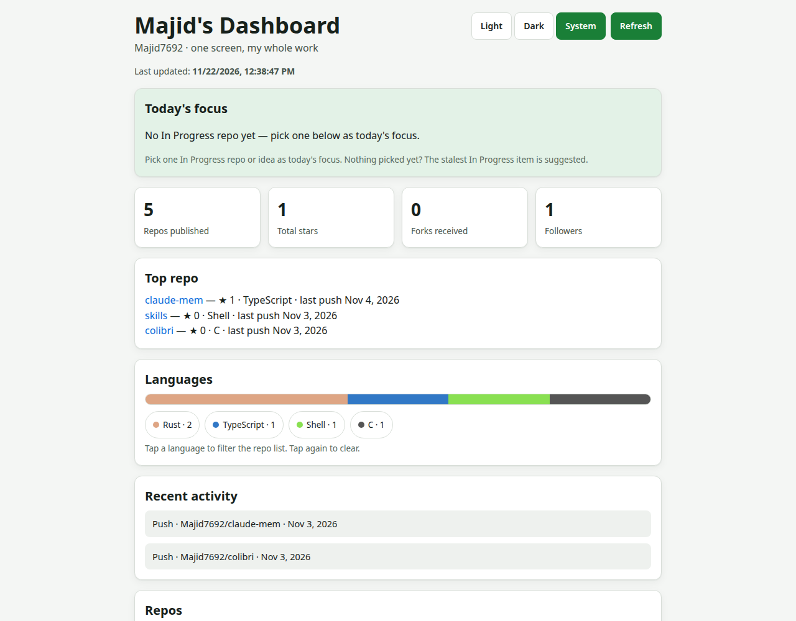
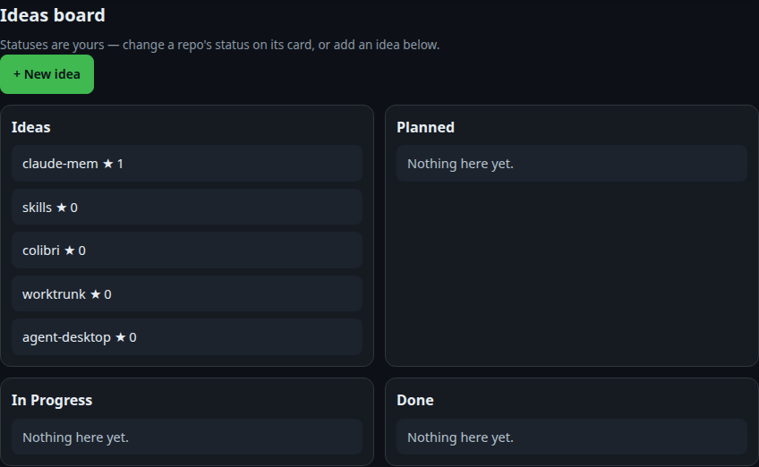
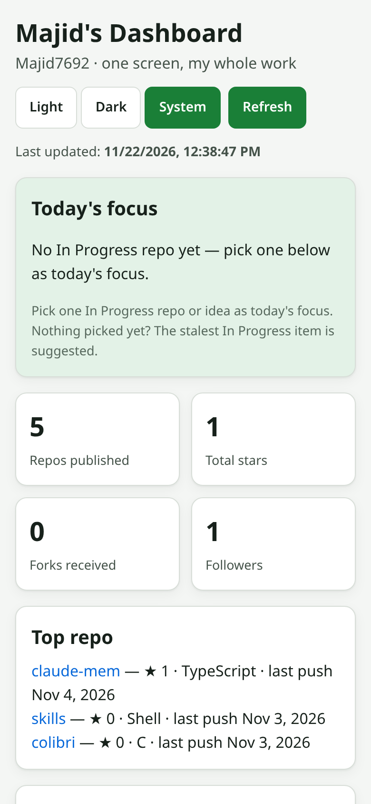

# Open Dashboard — v1.0.0

One screen showing my whole GitHub work — real repos, stars, last push dates, and an Ideas board. Built from scratch, my own code, under my name only.


*Desktop — light mode, top numbers and repo list.*


*Dark mode — Ideas board with all four columns.*


*Mobile — single-column layout, no sideways scroll.*

Live demo: https://majid7692.github.io/open-dashboard/

## Features

- **Real numbers only** — repos, stars, forks, followers from the GitHub API, cached, with "last updated" always visible. Never fake numbers.
- **Repo list + Ideas board** — statuses Idea / Planned / In Progress / Done (no "Pending"), 30-day staleness flag only on In Progress/Planned.
- **Today's focus, top repos, languages** — top 3 by stars, top 5 languages with tap-to-filter, recent activity feed.
- **Manual token box** — usage limit and remaining balance, typed in by hand. No token in code, ever.
- **Phone-first + dark mode** — works from 320px, Light / Dark / System saved, 44px tap targets.

## What it shows

- **Top numbers:** total repos published, total stars, forks received, followers — real GitHub data, never fake numbers. If data is not loaded yet, the page says "not loaded yet".
- **Repo list:** every repo with stars, last push date, and status (Idea / Planned / In Progress / Done only — there is NO "Pending" status). Change a status on the card itself.
- **Staleness warning:** flags ONLY an In Progress or Planned repo not touched in 30+ days. NEVER flags a Done repo — finished means finished. Never flags Idea repos either.
- **Ideas board:** four columns — Ideas, Planned, In Progress, Done.
- **Token / limits box:** my usage limit and remaining balance. Manual entry only — there is no automatic API for this. Never asked for in chat.
- **Refresh:** auto-refresh every 24 hours, plus a Refresh button. Always shows "last updated" time.
- **Cached data:** the page reads saved JSON first (`data/current.json`). It calls GitHub live only when the cache is older than 24 hours or I tap Refresh — never on every page load.
- **V1 extras:** phone-first single-column layout, dark mode (Light / Dark / System, choice saved), search (name + description) with status chips and sort by stars / last push / name, quick actions (tap a repo row to open it on GitHub, "+ New idea" button, status on the card), recent activity feed (last ~10 pushes / PRs / releases, from the GitHub Events API, cached with the 24h refresh), "Today's focus" card at the top, top repo highlight (top 3 by stars), language bar (top 5 languages by repo count, GitHub colours, tap to filter), JSON export/import backup of manual data only (statuses, ideas, focus pick, token box) in Settings.

## What it does NOT do (v2, later)

Contribution graph, streaks, per-repo notes, "needs attention" list, push notifications, goals/Gantt charts, star-trend history.

## Install

```bash
git clone https://github.com/Majid7692/open-dashboard.git
cd open-dashboard
python3 collect.py        # fetch live public GitHub data into data/
python3 -m http.server 8000
# open http://localhost:8000/
```

Or open `index.html` directly in a browser (the page reads `data/*.json` from the same folder).

`collect.py` uses the Python standard library only, no token, no password. Public GitHub reads are free (60 requests/hour unauthenticated). If the API fails, the old cache is left untouched.

## Step by step: apna username dalna (make it yours)

The username `Majid7692` is written in only 3 places. Change all 3 to your own GitHub username — nothing else needs your username.

**Step 1 — `collect.py`, line 26:**

```python
USERNAME = "Majid7692"
```

Change `"Majid7692"` to `"YOUR-USERNAME"`.

**Step 2 — `app.js`, line 7:**

```js
var USERNAME = "Majid7692";
```

Change `"Majid7692"` to `"YOUR-USERNAME"` (same name as step 1).

**Step 3 — `index.html`, line 16 (only the text under the title):**

```html
<p class="sub">Majid7692 · one screen, my whole work</p>
```

Change `Majid7692` to your name or username.

**Step 4 — fresh data lo:**

```bash
python3 collect.py
```

This fetches YOUR repos, stars, forks and followers into `data/`.

**Step 5 — browser mein dekho:**

```bash
python3 -m http.server 8000
# open http://localhost:8000/ and tap Refresh
```

Your real numbers appear. Statuses start as "Idea" for every repo — change them on the card, they are not guessed.

**Note:** no password, no token, no login is ever needed. Public repos and stars are free to read from the GitHub API. Never put a token in these files.

## Step by step: apne workflow ke hisab se badalna

Everything below is a small, one-line change. Change one thing, refresh the page, check it works, then change the next.

**1. Repo ka status badalna**

- Easiest: repo card par status dropdown se badlo (Idea / Planned / In Progress / Done). It saves in your browser.
- Or edit `data/manual.json` — `"statuses"` mein repo ka naam likho aur status do:

```json
"statuses": { "my-repo": "In Progress" }
```

**2. Stale kitne din baad flag ho — `app.js`, line 70**

```js
return d !== null && d >= 30;
```

`30` ko apne din se badlo. Example: `14` matlab 14 din se untouched In Progress/Planned repo par flag. Done aur Idea repos par kabhi flag nahi lagta.

**3. Auto-refresh kitne ghante baad — `app.js`, line 9**

```js
var DAY = 24 * 60 * 60 * 1000;
```

`24` ko apne ghante se badlo. Example: `12 * 60 * 60 * 1000` matlab har 12 ghante baad. Refresh button hamesha manual refresh karta hai.

**4. Top repos kitne dikhein — `app.js`, line 111**

```js
.slice(0, 3)
```

`3` ko badlo — example `5` matlab top 5 repos by stars.

**5. Language bar mein kitni languages — `app.js`, line 128**

```js
.slice(0, 5)
```

`5` ko badlo — example `3` matlab top 3 languages.

**6. Activity feed mein kitne events — `app.js`, line 156**

```js
events.slice(0, 10)
```

`10` ko badlo — example `20` matlab last 20 pushes / PRs / releases.

**7. Idea add karna**

- Page par **"+ New idea"** button se likho, ya
- `data/manual.json` mein `"ideas"` list mein add karo:

```json
"ideas": [{ "title": "My next app", "status": "Idea" }]
```

**8. Today's focus pick karna**

- "Today's focus" card par kisi In Progress repo ya idea ko pick karo. Koi pick nahi hai to page khud sabse stale In Progress repo suggest karta hai.

**9. Token / limits box**

- Page par token box mein apna usage limit aur remaining balance khud likho aur Save karo. Ye manual hai — koi automatic API nahi hai, aur koi token ya password yahan kabhi nahi likhna.

**10. Apna data backup lena**

- Settings mein **JSON export** se apna manual data (statuses, ideas, focus, token box) download karo. Wapas lane ke liye **JSON import** use karo. GitHub data (`data/current.json`) export nahi hota — wo `collect.py` se dobara ban jata hai.

**12. Theme link share karna**

Page ke link mein `?theme=dark` (ya `?theme=light`, `?theme=system`) jod do — khulne par wohi theme lagega, aur dekhne wale ki saved theme choice nahi badlegi.

**13. Apna kaam save karne ka tareeqa (one project at a time)**

- Pehle project ko run karke confirm karo ke wo as-is kaam karta hai, phir chhoti change karo, test karo.
- Pehli publish ke baad kabhi seedha `main` par commit mat karo — hamesha feature branch banao, phir merge karo.

## How to publish (new empty repo)

The repo is `Majid7692/open-dashboard`. First publish, from this folder:

```bash
git init
git add .
git commit -m "v1.0.0 - my own version"
git branch -M main
git remote add origin https://github.com/Majid7692/open-dashboard.git
git push -u origin main
```

After the first publish, new work goes on a feature branch — never commit directly to `main`.

## Data files

- `data/current.json` — latest GitHub snapshot (generated by `collect.py`, real data).
- `data/events.json` — recent pushes / PRs / releases (generated).
- `data/history.json` — one entry per day (for later charts, not shown in v1.0.0).
- `data/manual.json` — my manual data: statuses, ideas, focus pick, token box. Statuses start as "Idea" for all 5 repos — change them on the card, they were not guessed.

## How to update

See [CONTRIBUTING.md](CONTRIBUTING.md) — feature branch only, one small change at a time, run + test it, update `CHANGELOG.md`, open a Pull Request, then tag a release (`v1.0.1` bug fix, `v1.1.0` new feature, `v2.0.0` breaking change).

## License

MIT — see `LICENSE`. Free to use, copy, modify and share, with the license and copyright notice kept.
